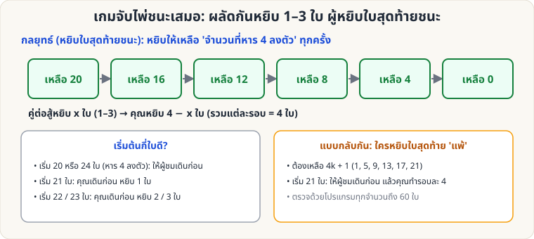

[🏠 หน้าแรก](../Home.md) › [🧮 ไพ่คำนวณ](../Self-Working-Medium.md) › เกมจับไพ่ชนะเสมอ

# เกมจับไพ่ชนะเสมอ (Nim 1–3 ใบ)

> 🟡 **ระดับกลาง** · 🧮 ไพ่คำนวณ · ⏱ 20 นาที · 🔢 มีการคำนวณ

<!-- title:เกมจับไพ่ชนะเสมอ (Nim 1–3 ใบ) -->
<!-- body:start -->
**ผลที่ผู้ชมเห็น:** คุณท้าให้ผู้ชมเล่นเกมไพ่: ผลัดกันหยิบไพ่จากกองครั้งละ 1, 2 หรือ 3 ใบ ใครหยิบใบสุดท้ายชนะ — **คุณชนะทุกครั้ง**

**อุปกรณ์:** ไพ่ 20–24 ใบ (วางเป็นกองเดียว)

**กลยุทธ์ (ผู้หยิบใบสุดท้ายชนะ)**

- ไพ่ที่เหลือ **หาร 4 ลงตัว** = ผู้ที่ต้องเดินต่อ **แพ้** (ถ้าอีกฝ่ายเล่นถูก)
- ดังนั้นเดินให้ **เหลือจำนวนที่หาร 4 ลงตัว** ทุกครั้ง: ถ้าผู้ชมหยิบ x ใบ คุณหยิบ **4 − x** ใบ (รวมแต่ละรอบ = 4)

| เริ่มด้วย | ใครเดินก่อน | ท่าแรก |
|---|---|---|
| 20 หรือ 24 ใบ | **ผู้ชม** | (ผู้ชมเดินอะไร คุณตามด้วย 4 − x) |
| 21 ใบ | **คุณ** | หยิบ 1 ใบ |
| 22 ใบ | **คุณ** | หยิบ 2 ใบ |
| 23 ใบ | **คุณ** | หยิบ 3 ใบ |

**แบบกลับกัน (ใครหยิบใบสุดท้าย "แพ้")**

- ต้องเดินให้เหลือ **4k + 1** ใบ (1, 5, 9, 13, 17, 21, …)
- เริ่มด้วย 21 ใบ → ให้ **ผู้ชมเดินก่อน** แล้วคุณทำรอบละ 4 ใบ (ใบสุดท้ายตกเป็นของผู้ชม)

**ตรวจแล้ว:** ค้นหาเกมเต็ม (minimax) ทุกจำนวนไพ่ 0–60 ใบ ทั้งสองแบบ — ฝ่ายที่ถูกกำหนดว่าชนะ ชนะได้เสมอ

**ข้อควรระวัง:** เล่นซ้ำกับคนเดิมหลายรอบคนจับกลยุทธ์ได้ง่าย — เปลี่ยนจำนวนเริ่มต้นหรือเปลี่ยนเป็นแบบ "แพ้" ในรอบถัดไป
<!-- body:end -->

---

⬅️ [🟡 โป๊กเกอร์ดีล](sw-medium-poker-deal.md)  ·  [📋 ไพ่คำนวณ · ระดับกลาง ทั้งหมด](../Self-Working-Medium.md)  ·  [🟡 เลข 1001](sw-medium-1001.md) ➡️

**กลที่เกี่ยวข้อง:** [🔴 Nim สามกอง](sw-hard-nim-sum.md)
