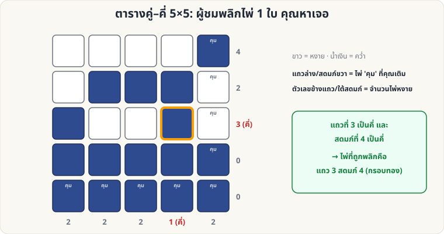

[🏠 หน้าแรก](../Home.md) › [🧮 ไพ่คำนวณ](../Self-Working-Medium.md) › ตารางคู่–คี่ 5×5

# ตารางคู่–คี่ 5×5 (หาไพ่ที่ถูกพลิก)

> 🟡 **ระดับกลาง** · 🧮 ไพ่คำนวณ · ⏱ 30 นาที · 🔢 มีการคำนวณ

<!-- title:ตารางคู่–คี่ 5×5 (หาไพ่ที่ถูกพลิก) -->
<!-- body:start -->
**ผลที่ผู้ชมเห็น:** ไพ่ 25 ใบวางเป็นตาราง 5×5 คว่ำ/หงายปะปน คุณหันหลัง ผู้ชมพลิกไพ่ 1 ใบ — คุณกลับมาแล้ว **ชี้ได้ว่าใบไหนถูกพลิก**

**อุปกรณ์:** ไพ่ 25 ใบ (ใบอะไรก็ได้ แต่ละใบมีด้านหงายกับคว่ำต่างกันชัดเจน)

**วิธีเตรียม**

1. ให้ผู้ชมวางไพ่ **16 ใบ** (4×4) คว่ำ/หงาย ตามใจ
2. คุณเพิ่มไพ่ **9 ใบ** เป็นแถวที่ 5 และสดมภ์ที่ 5 ("ไพ่คุม"): แต่ละแถว/สดมภ์ ให้ใบสุดท้าย **หงายหรือคว่ำ** เพื่อให้ **จำนวนหงายในแถว/สดมภ์นั้นเป็นเลขคู่** (ไพ่คุมมุมล่างขวาจัดตามแถวล่าง แล้วจะถูกทั้งสดมภ์ขวาด้วย)
3. ตอนนี้ **ทุกแถวและทุกสดมภ์** ของตาราง 5×5 มีไพ่หงายเป็นเลขคู่

**วิธีเล่น**

1. คุณหันหลัง ผู้ชม **พลิกไพ่ 1 ใบ** (ใบไหนก็ได้ รวมถึงไพ่คุม)
2. คุณหันกลับมา **นับไพ่หงายทีละแถว ทีละสดมภ์** → จะมี **แถวหนึ่ง และสดมภ์หนึ่ง** ที่เป็นเลข **คี่**
3. **จุดตัดของแถวคี่และสดมภ์คี่** = ไพ่ที่ถูกพลิก (ตัวอย่างในภาพ: แถว 3, สดมภ์ 4)
4. ถ้าไม่มีแถวคี่เลย แสดงว่าผู้ชมไม่ได้พลิก

**ทำไมถึงได้ผล:** การพลิกไพ่ 1 ใบเปลี่ยนจำนวนไพ่หงายของแถวและสดมภ์ของใบนั้นทีละ 1 → ทั้งสองกลายเป็นเลขคี่ ส่วนที่เหลือเป็นเลขคู่ตามเดิม (ตรวจกับตาราง 3,000 ชุดแล้ว รวมกรณีพลิกไพ่คุม/มุมล่างขวา)

**ต่อยอด:** วิธีเดียวกันกับ [Hamming 7 ใบ](sw-hard-hamming-7.md) แต่เป็นสองมิติ — ตารางใหญ่ขึ้นก็ใช้ได้ (n × n)
<!-- body:end -->

---

⬅️ [🟡 ผลรวม 10 ตัวเลข](sw-medium-fibonacci-sum.md)  ·  [📋 ไพ่คำนวณ · ระดับกลาง ทั้งหมด](../Self-Working-Medium.md)  ·  [🟡 กองถึง 10](sw-medium-pile-to-ten.md) ➡️

**กลที่เกี่ยวข้อง:** [🔴 Hamming 7 ใบ](sw-hard-hamming-7.md) · [🟢 คว่ำ–หงาย (คู่–คี่)](sw-easy-parity.md)
