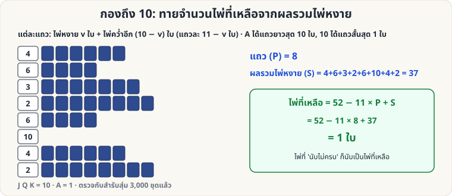

[🏠 หน้าแรก](../Home.md) › [🧮 ไพ่คำนวณ](../Self-Working-Medium.md) › กองถึง 10

# กองถึง 10 (ทายจำนวนไพ่ที่เหลือ)

> 🟡 **ระดับกลาง** · 🧮 ไพ่คำนวณ · ⏱ 30 นาที · 🔀 ผู้ชมสับสำรับได้ · 🔢 มีการคำนวณ · 📝 เล่นแบบทำนายได้

<!-- title:กองถึง 10 (ทายจำนวนไพ่ที่เหลือ) -->
<!-- body:start -->
**ผลที่ผู้ชมเห็น:** ผู้ชมสับสำรับเอง แล้วแจกไพ่เป็นแถว ๆ ตามกติกา "นับต่อให้ครบ 10" จนแจกต่อไม่ได้ — คุณ **ทายจำนวนไพ่ที่เหลือในมือ** ได้ทันที จากแค่ดูไพ่หงายหัวแถว

**อุปกรณ์:** สำรับ 52 ใบ (ผู้ชมสับเองได้เต็มที่)

**ค่าไพ่:** A = 1, 2–9 ตามเลข, 10 J Q K = 10

**กติกาแจก (ทำซ้ำเป็นแถว ๆ)**

1. **หงายไพ่ใบบนสุด** วางเป็นหัวแถว (ค่า v)
2. **แจกไพ่คว่ำอีก (10 − v) ใบ** ต่อท้ายแถว (เช่น หงาย 7 → คว่ำต่ออีก 3 ใบ; ถ้าหงาย 10 → ไม่ต้องต่อ)
3. เริ่มแถวใหม่ด้วยการหงายใบถัดไป
4. **หยุดเมื่อไพ่ในมือไม่พอ** ต่อให้ครบแถว (ไพ่ใบที่หงายแล้วแต่ต่อไม่ครบ นับเป็นไพ่ที่เหลือ)

**คุณคำนวณ:** นับ **จำนวนแถวที่ต่อครบ = P** และ **รวมค่าไพ่หงายหัวแถวที่ต่อครบ = S**

> ไพ่ที่เหลือ = **52 − 11 × P + S**

ตัวอย่าง: 8 แถว ไพ่หงาย 4, 6, 3, 2, 6, 10, 4, 2 (S = 37) → 52 − 88 + 37 = **1 ใบ** ✓

**ทำไมถึงได้ผล:** แต่ละแถวที่ต่อครบใช้ไพ่ 1 + (10 − v) = **11 − v ใบ** → ไพ่ที่ใช้ไปทั้งหมด = 11P − S → ไพ่ที่เหลือ = 52 − (11P − S)

**ตรวจแล้ว:** สับสำรับสุ่ม 3,000 ชุด สูตรตรงทุกชุด

**ลูกเล่น:** ให้ผู้ชมเขียนจำนวนไพ่ที่เหลือที่เดาไว้ก่อน แล้วค่อยนับเทียบกับคำทำนายของคุณ · หรือให้นับไพ่ที่เหลือก่อนเปิดไพ่ใบสุดท้าย
<!-- body:end -->

---

⬅️ [🟡 ตารางคู่–คี่ 5×5](sw-medium-parity-grid.md)  ·  [📋 ไพ่คำนวณ · ระดับกลาง ทั้งหมด](../Self-Working-Medium.md)  ·  [🔴 Fitch–Cheney 5 ใบ](sw-hard-fitch-cheney.md) ➡️

**กลที่เกี่ยวข้อง:** [🟡 Kruskal Count](sw-medium-kruskal.md)
