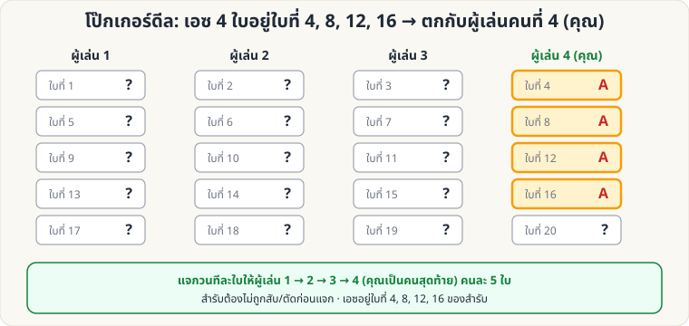

[🏠 หน้าแรก](../Home.md) › [🧮 ไพ่คำนวณ](../Self-Working-Medium.md) › โป๊กเกอร์ดีล

# โป๊กเกอร์ดีล: เอซ 4 ใบเข้ามือคุณ

> 🟡 **ระดับกลาง** · 🧮 ไพ่คำนวณ · ⏱ 10 นาที · 🔧 ต้องจัดสำรับล่วงหน้า

<!-- title:โป๊กเกอร์ดีล: เอซ 4 ใบเข้ามือคุณ -->
<!-- body:start -->
**ผลที่ผู้ชมเห็น:** คุณแจกไพ่ให้ผู้เล่น 4 คน (รวมตัวคุณ) คนละ 5 ใบ ตามปกติ ผู้ชมเปิดมือคุณ → **เอซครบ 4 ใบ**

**อุปกรณ์:** สำรับที่จัดให้ **เอซอยู่ใบที่ 4, 8, 12, 16 จากบนสุด** (ใบอื่นอะไรก็ได้)

**วิธีทำ**

1. ถือสำรับที่จัดไว้ ห้ามสับ/ตัด
2. แจกวนทีละใบ ผู้เล่น 1 → 2 → 3 → **4 (คุณ)** จนแต่ละคนได้ 5 ใบ (รวม 20 ใบ)
3. ใบที่ 4, 8, 12, 16 ตกอยู่กับผู้เล่น 4 พอดี → **A A A A + ใบที่ 20**

**ต่อยอด**

- **Royal Flush:** วางไพ่ 10 J Q K A ดอกเดียวกัน ที่ใบที่ 4, 8, 12, 16, 20 → มือคุณเป็นรอยัลฟลัช
- ให้ผู้ชมเป็นคนแจกเอง แต่ห้ามสับ/ตัด — คุณเป็น "ผู้เล่นคนสุดท้ายที่ได้ไพ่"

> ⚠️ นี่คือมายากลเพื่อความบันเทิง **ห้ามใช้กับการพนันจริง**
<!-- body:end -->

---

⬅️ [🟡 Stebbins: ตำแหน่ง → ไพ่](sw-medium-stebbins-formula.md)  ·  [📋 ไพ่คำนวณ · ระดับกลาง ทั้งหมด](../Self-Working-Medium.md)  ·  [🟡 เกมจับไพ่ชนะเสมอ](sw-medium-nim-21.md) ➡️

**กลที่เกี่ยวข้อง:** [🟢 เอซ 4 กอง](sw-easy-four-aces.md)
