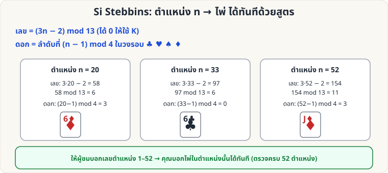

[🏠 หน้าแรก](../Home.md) › [🧮 ไพ่คำนวณ](../Self-Working-Medium.md) › Stebbins: ตำแหน่ง → ไพ่

# Si Stebbins: ตำแหน่ง → ไพ่ (Any Number)

> 🟡 **ระดับกลาง** · 🧮 ไพ่คำนวณ · ⏱ 1 วัน · 🔧 ต้องจัดสำรับล่วงหน้า · 🧠 ต้องท่องจำ · 🔢 มีการคำนวณ

<!-- title:Si Stebbins: ตำแหน่ง → ไพ่ (Any Number) -->
<!-- body:start -->
ต่อจาก [Si Stebbins Stack](sw-medium-stebbins.md): นอกจากหา "ไพ่ถัดไป" ยังหาไพ่ใน **ตำแหน่งใดก็ได้** ด้วยสูตร

**สูตร** (ตำแหน่ง n นับจากบน = 1)

- **เลข** = (3n − 2) mod 13 (ถ้าได้ 0 ใช้ K) — ย่อให้ n mod 13 ก่อนจะง่ายขึ้น เช่น n = 33 → 33 mod 13 = 7 → 3·7 − 2 = 19 → 19 mod 13 = **6**
- **ดอก** ดูจาก n mod 4: **1 = ♣, 2 = ♥, 3 = ♠, 0 = ♦**

**ตัวอย่าง:** n = 20 → เลข (60−2=58) mod 13 = 6, n mod 4 = 0 → ♦ → **6♦** (ตรวจครบ 52 ตำแหน่งแล้ว)

**ใช้เล่น:** ผู้ชมบอกเลข 1–52 → คุณบอกไพ่ที่ตำแหน่งนั้น · หรือให้ผู้ชมนับไพ่ลงโต๊ะตามเลข แล้วคุณทายก่อนพลิก
<!-- body:end -->

---

⬅️ [🟡 ไพ่ 25 ใบ](sw-medium-25-cards.md)  ·  [📋 ไพ่คำนวณ · ระดับกลาง ทั้งหมด](../Self-Working-Medium.md)  ·  [🟡 โป๊กเกอร์ดีล](sw-medium-poker-deal.md) ➡️

**กลที่เกี่ยวข้อง:** [🟡 Si Stebbins Stack](sw-medium-stebbins.md) · [🔴 Stebbins ย้อนกลับ](sw-hard-stebbins-crt.md)
